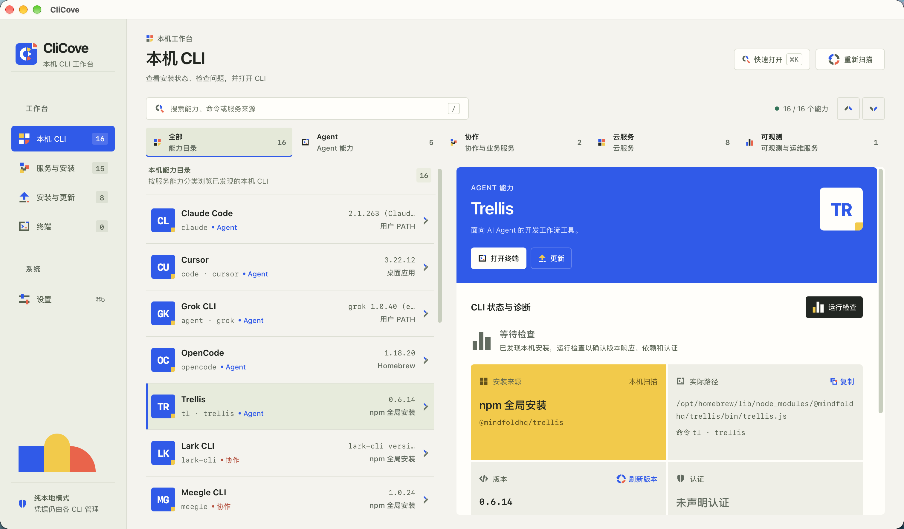
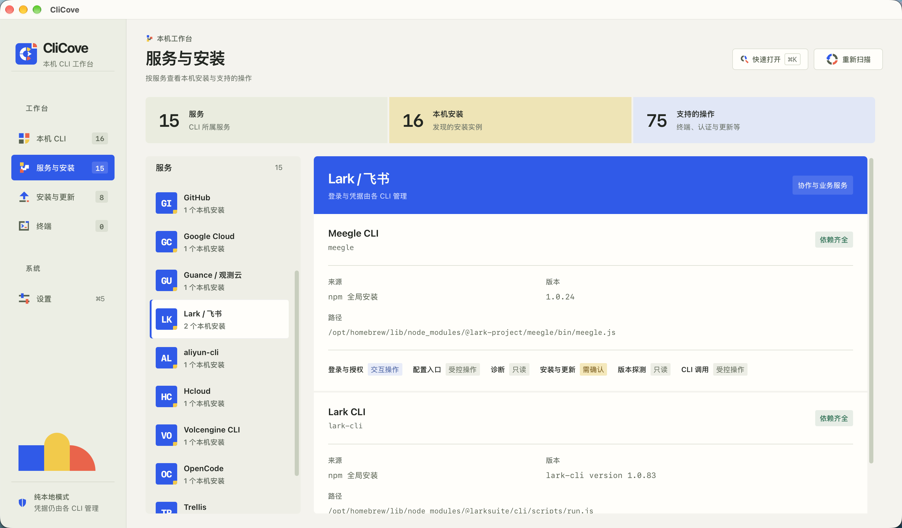
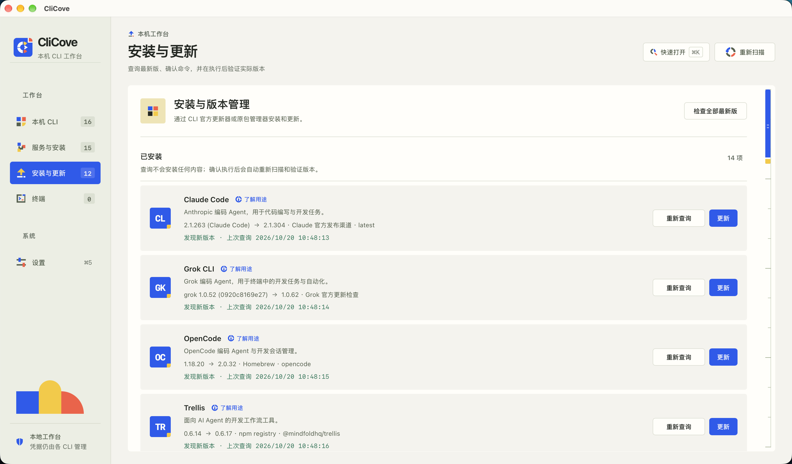

# CliCove

**简体中文** | [English](README.en.md)

面向开发者的本地 CLI 桌面工作台。

在一个窗口中查看本机 CLI、检查运行状态、管理安装与更新，并打开终端会话。无论是 AI 编码工具、云服务还是协作工具，都可以集中查找和使用。



## 主要功能

- **本机 CLI 目录**：自动发现已安装的工具，按类别浏览、搜索，查看版本与安装来源。
- **服务与安装**：按服务整理工具，查看同一服务的多个安装及可用操作。
- **安装与更新**：查询最新版本，预览并确认操作，执行后验证实际版本。
- **状态与诊断**：检查运行依赖、登录状态与常见问题，快速进入登录或配置操作。
- **内置终端**：在应用内运行 CLI，管理多个会话，随时切换工作。
- **应用更新**：发现 CliCove 新版本后，可立即更新、稍后提醒或跳过此版本。
- **本地使用**：无需注册 CliCove 账号，登录与凭据继续由各 CLI 管理。

## 界面预览

| 服务与安装 | 安装与更新 |
| --- | --- |
|  |  |

## CLI 目录

| 类别 | 工具示例 |
| --- | --- |
| AI 与 Agent | Codex、Claude Code、Grok CLI、OpenCode、Trellis |
| 协作与业务 | Lark CLI、Meegle CLI |
| 云服务 | Aliyun、AWS CLI、Azure CLI、Google Cloud CLI、Volcengine CLI、Cloudflare Wrangler、Vercel CLI |
| 可观测与运维 | Owl |

也可以通过[自定义适配器](docs/ADAPTER_DEVELOPMENT.md)扩展更多工具。

## 快速开始

准备 Node.js 22.12+、Rust stable，以及 [Tauri 2 所需的系统依赖](https://v2.tauri.app/start/prerequisites/)。

```bash
git clone https://github.com/cherrycove/CliCove.git
cd CliCove
npm ci
npm run tauri dev
```

面向 macOS 和 Windows。

## 常用快捷键

| 快捷键 | 操作 |
| --- | --- |
| `⌘ / Ctrl + K` | 搜索页面与 CLI |
| `⌘ / Ctrl + 1–5` | 切换主要页面 |
| `/` | 聚焦 CLI 搜索框 |

## 参与贡献

欢迎通过 [Issue](https://github.com/cherrycove/CliCove/issues) 反馈问题、提出建议，或提交 Pull Request。

可以从新增 CLI 适配、改进界面、完善文档或补充 Windows 验证开始。适配器开发请参考[开发指南](docs/ADAPTER_DEVELOPMENT.md)和[示例配置](docs/adapter.example.json)。

本地检查：

```bash
npm run check
npm test
cargo test --manifest-path src-tauri/Cargo.toml
```

## 开源许可

[MIT](LICENSE)
